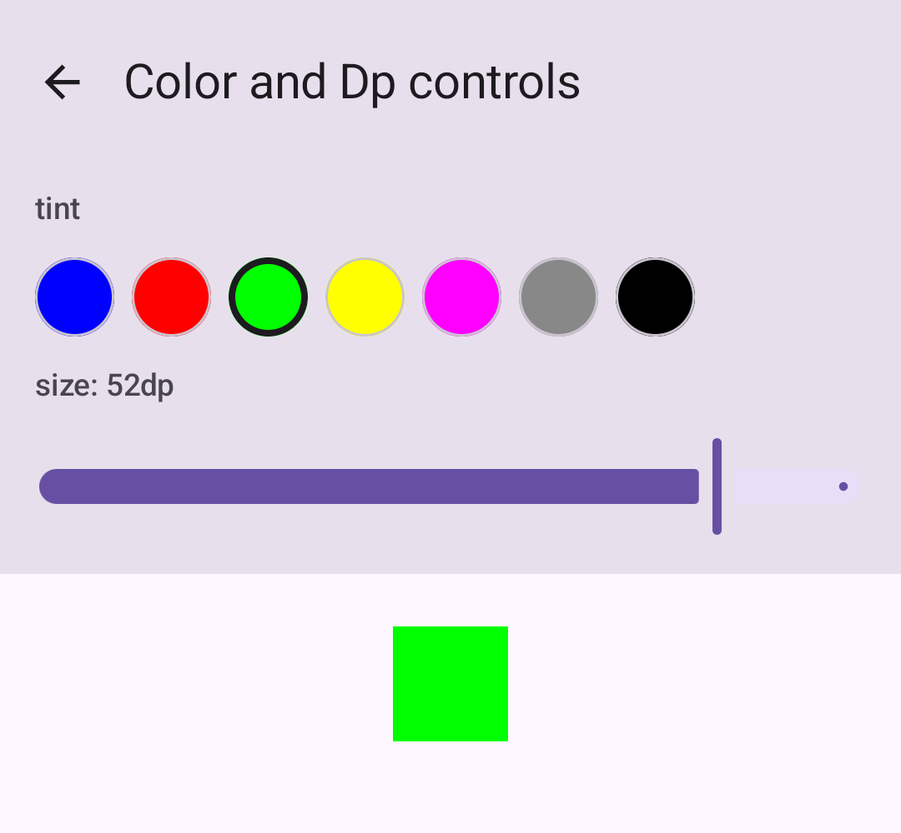
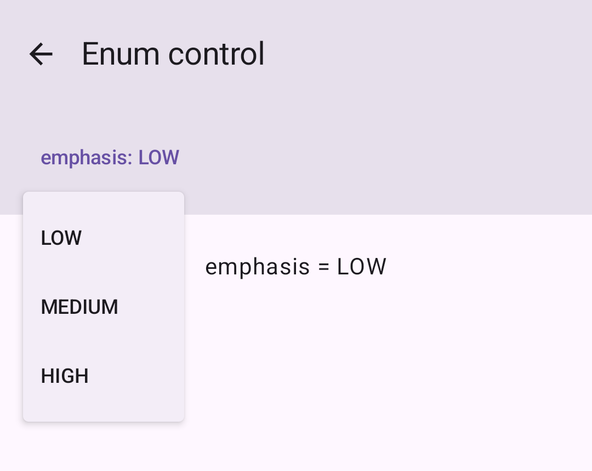
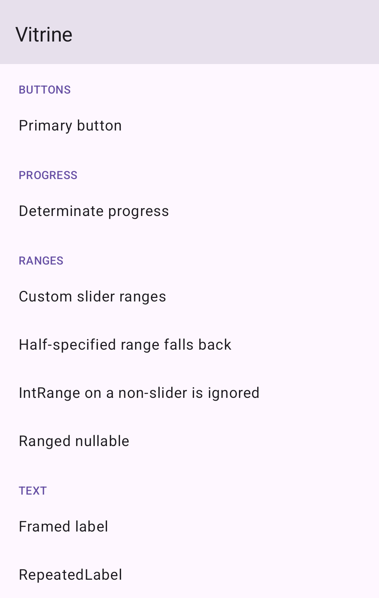

# Vitrine

[](https://central.sonatype.com/artifact/io.github.simtop/vitrine-processor)
[](https://github.com/simtop/vitrine/actions/workflows/ci.yml)
[](LICENSE)

**A KSP-generated, interactive component catalog for Jetpack Compose.**

Annotate a composable and Vitrine generates a playground for it: a Material 3 control for every
supported parameter, wired to state, rendered above a live instance of the component. Change the
text, tick the checkbox, drag the slider — the component recomposes. No catalog screen to maintain,
no registration step, and it works across a multi-module project.

<p align="center">
  
  
</p>

Above: a `Color` parameter as a swatch row and a `Dp` parameter as a slider — the square below the
controls is what the component renders, and it tracks them. On the right, an `enum` parameter as a
dropdown over its own entries. Neither is a pre-baked preview; both are live.

The generated layout puts the controls on a tinted surface and the component on the plain
background below it, so *what you can change* and *what it looks like* are told apart without a
caption.

Every annotated component across every module, listed by tab:

<p align="center">
  
</p>

*(Screenshots are from [`sample-app`](sample-app) in this repo — `./gradlew :sample-app:installDebug`
to run it yourself.)*

## Quick start

```kotlin
// build.gradle.kts
plugins {
    id("com.google.devtools.ksp") version "2.3.9"
}

dependencies {
    implementation("io.github.simtop:vitrine-annotations:0.1.0")
    ksp("io.github.simtop:vitrine-processor:0.1.0")
}
```

Annotate your composables:

```kotlin
@VitrineComponent(tab = "Buttons", name = "Primary button")
@Composable
fun PrimaryButton(label: String, enabled: Boolean) {
    Button(onClick = {}, enabled = enabled) { Text(label) }
}
```

Render the catalog:

```kotlin
@Composable
fun CatalogScreen() {
    val items = remember { loadVitrineItems() }
    LazyColumn {
        items(items) { item ->
            Text(item.name, style = MaterialTheme.typography.titleMedium)
            item.content()
        }
    }
}
```

`loadVitrineItems()` collects every module's generated provider through `ServiceLoader`, so adding a
component to any module makes it appear — no central list to update.

## What gets generated

For the annotation above, Vitrine writes a wrapper next to your component:

```kotlin
@Composable
public fun PrimaryButton_VitrineWrapper() {
  var label by remember { mutableStateOf("Default Value") }
  var enabled by remember { mutableStateOf(false) }

  Column(modifier = Modifier.fillMaxWidth()) {
    Surface(modifier = Modifier.fillMaxWidth(), color = MaterialTheme.colorScheme.surfaceVariant) {
      Column(modifier = Modifier.padding(16.dp), verticalArrangement = Arrangement.spacedBy(12.dp)) {
        TextField(value = label, onValueChange = { label = it }, label = { Text("label") })
        Row(
          modifier = Modifier.fillMaxWidth(),
          verticalAlignment = Alignment.CenterVertically,
          horizontalArrangement = Arrangement.SpaceBetween,
        ) {
          Text("""enabled""", style = MaterialTheme.typography.labelLarge)
          Checkbox(checked = enabled, onCheckedChange = { enabled = it })
        }
      }
    }
    Box(modifier = Modifier.fillMaxWidth().padding(24.dp), contentAlignment = Alignment.Center) {
      PrimaryButton(label = label, enabled = enabled)
    }
  }
}
```

The generated code is meant to be read, so it uses `Arrangement.spacedBy` rather than emitting a
`Spacer` between every control.

…plus one `VitrineProvider` per module, registered as a `ServiceLoader` service.

## Supported parameter types

| Kotlin type | Control | Initial value |
|---|---|---|
| `String` | `TextField` | `"Default Value"` |
| `Boolean` | `Checkbox` | `false` |
| `Int` | `TextField` (numeric keyboard) | `0` |
| `Long` | `TextField` (numeric keyboard) | `0L` |
| `Float` | `Slider`, `0f..1f` by default | `0f` |
| `Double` | `Slider`, `0.0..1.0` by default | `0.0` |
| `Dp` | `Slider`, `0.dp..64.dp` by default | `8.dp` |
| `Color` | Row of clickable swatches | `Color.Blue` |
| any `enum class` | `DropdownMenu` over its entries | the enum's first entry |
| `T?` for any of the above | `Checkbox` gating `T`'s control | the inner control's initial value, present |

A nullable parameter holds its value and its presence separately, so toggling it off and back on
does not discard what you typed.

### Slider ranges

Sliders default to `0f..1f` (`Float`, `Double`) and `0.dp..64.dp` (`Dp`). Annotate the parameter to
change that:

```kotlin
@VitrineComponent(tab = "Layout")
@Composable
fun Card(
    @VitrineRange(from = 0.0, to = 320.0) width: Dp,
    @FloatRange(from = -50.0, to = 50.0) offset: Double,
) { /* … */ }
```

Both annotations work, and there is a reason for the overlap: **AndroidX's `@FloatRange` is only
legal on `Float` and `Double`.** Put it on a `Dp` and Android Lint fails the build with
`SupportAnnotationUsage: expected float or double`. So `@VitrineRange` exists for the types AndroidX
doesn't cover, and Vitrine reads `@FloatRange`/`@IntRange` as well so a codebase that already
documents its bounds doesn't have to repeat them. When both are on one parameter, `@VitrineRange`
wins.

Use `@FloatRange` where it is legal — it documents the constraint to every other tool too. Reach for
`@VitrineRange` for `Dp`.

A range whose bounds aren't finite and ascending is ignored and the control keeps its default span.
That matters in practice: `@FloatRange(from = 0.0)` leaves `to` at positive infinity, and a slider
over an infinite span cannot be positioned.

The starting value is pulled inside the range when it falls outside — a `Dp` bounded to `100..200`
starts at `100.dp`, not at the usual `8.dp`.

### Any other type: `@PreviewParameter`

For types Vitrine has no control for — your own models, sealed hierarchies — supply the values with
Compose's own `@PreviewParameter`. No Vitrine-specific annotation to learn.

It comes from Compose's tooling artifact, which `vitrine-annotations` deliberately does not drag in
for everyone, so add it yourself if you use this:

```kotlin
dependencies {
    implementation("androidx.compose.ui:ui-tooling-preview")
}
```

```kotlin
class UserProvider : PreviewParameterProvider<User> {
    override val values = sequenceOf(User("Ada", 36), User("Grace", 45))
}

@VitrineComponent(tab = "Profile")
@Composable
fun UserBadge(@PreviewParameter(UserProvider::class) user: User) { /* … */ }
```

Vitrine renders a dropdown over the provider's values, labelled with each value's `toString()`.
`@PreviewParameter` takes precedence over the built-in mapping, so you can use it to pin a `String`
parameter to a fixed set of options instead of a free text field.

### When there is no control

A parameter with no control and no `@PreviewParameter` is left out of the generated call, so **it
must have a default value**. Vitrine will not invent a value for a type it doesn't understand, and
it tells you either way: a warning when it falls back to a default, and a **build error pointed at
your component** when the parameter has no default and the wrapper therefore couldn't call it.

## Configuration

All options are KSP arguments:

```kotlin
ksp {
    // Package for the generated provider. Default: io.github.simtop.vitrine.generated
    arg("vitrine.generatedPackage", "com.example.catalog.generated")

    // Provider class name. Default: derived from the module name,
    // e.g. :feature:beerslist -> FeatureBeerslistVitrineProvider
    arg("vitrine.providerName", "MyCatalogProvider")

    // "public" (default) or "internal".
    arg("vitrine.visibility", "public")
}
```

| Argument | Type | Default | Effect |
|---|---|---|---|
| `vitrine.generatedPackage` | String | `io.github.simtop.vitrine.generated` | Package of the generated provider |
| `vitrine.providerName` | String | `<ModuleName>VitrineProvider` | Class name of the generated provider. KSP supplies the **leaf** module name, so `:core:designsystem` yields `DesignsystemVitrineProvider` — set this explicitly if two modules share a leaf name |
| `vitrine.visibility` | `public` \| `internal` | `public` | Provider visibility. **`internal` suppresses the `ServiceLoader` entry** — an internal class can't be loaded reflectively from another module, so you must reference it directly. An unrecognised value fails the build rather than falling back silently |

### `demoContainer`

Some components need scaffolding to look right in isolation. Point the annotation at a sibling
function that provides it:

```kotlin
@VitrineComponent(tab = "Text", name = "Framed label", demoContainer = "FramedLabelDemo")
@Composable
fun FramedLabel(caption: String, modifier: Modifier = Modifier) { /* … */ }

@Composable
fun FramedLabelDemo(caption: String) {
    Surface { Box(Modifier.padding(12.dp)) { FramedLabel(caption) } }
}
```

Vitrine calls `FramedLabelDemo` instead. The container must be in the same package and accept the
same supported parameters.

## How it compares to Showkase

[Showkase](https://github.com/airbnb/Showkase) is the established tool in this space, it is actively
maintained, and for many projects it is the better choice. It reuses your existing `@Preview`
functions, browses colors and typography as well as components, and ships a full browser UI with
search and permutation support.

**The difference is interactivity.** Showkase renders each `@Preview` as its author wrote it — a
fixed set of pre-baked states. Vitrine generates *live controls* bound to component parameters, so
one annotation covers the whole input space instead of one point in it: a dropdown over an enum's
entries, a slider over a `Dp`, a checkbox that toggles a nullable between null and a real value.

Pick Showkase if you want a broad browser over previews you already have. Pick Vitrine if you want
to *manipulate* components — checking how a button behaves as a label grows, or what a progress bar
looks like at 0.37 — without writing a preview per case. They are not mutually exclusive; the
annotations are independent.

## Compatibility

Verified on exactly one configuration — the one [CI](.github/workflows/ci.yml) builds. These are
the versions this library has actually been run against, not a claimed support range:

| | Version |
|---|---|
| Kotlin | 2.4.0 |
| KSP | 2.3.9 (KSP2) |
| AGP | 9.2.1 |
| Gradle | 9.6.1 |
| compileSdk | 37 |
| minSdk | 21 (`vitrine-annotations`) |

Older KSP and AGP versions may well work; they have not been tested, so this table does not claim
them. A KSP/AGP version matrix is the next thing to add here, and the table will grow to match it.

## How it works

A KSP `SymbolProcessor` collects `@VitrineComponent` functions, maps each supported parameter type
to a Material 3 control, and emits the wrappers with [KotlinPoet](https://square.github.io/kotlinpoet/).
It then writes one aggregating `VitrineProvider` per module and a `META-INF/services` entry for it.
Generation is latched to a single KSP round, so the service file is written exactly once — writing
it per-round and swallowing the resulting `FileAlreadyExistsException` is a known way to produce
duplicate service entries that break packaging.

## Contributing

Issues and pull requests welcome. `make check` runs everything CI runs.

## License

[Apache 2.0](LICENSE)
